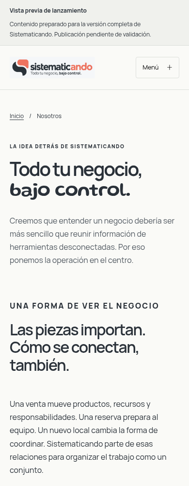
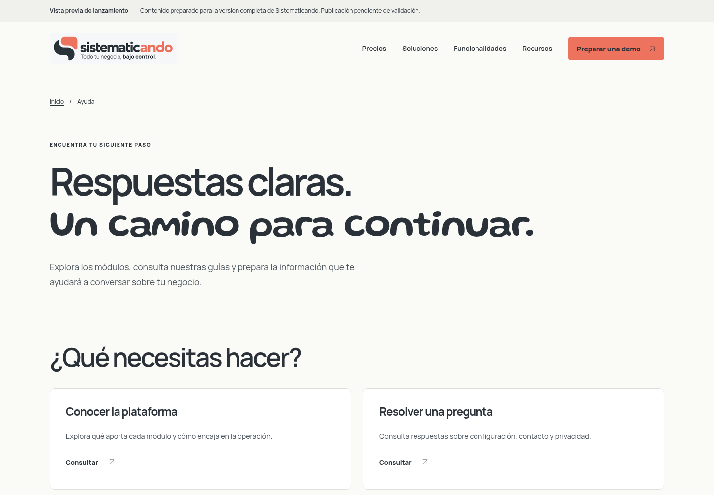
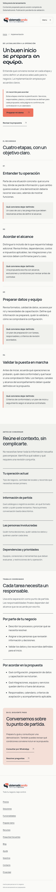
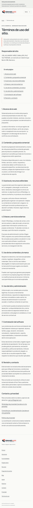
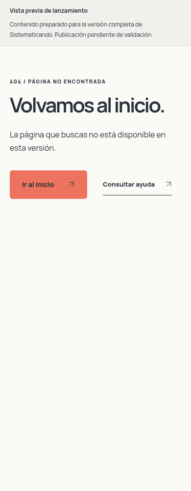
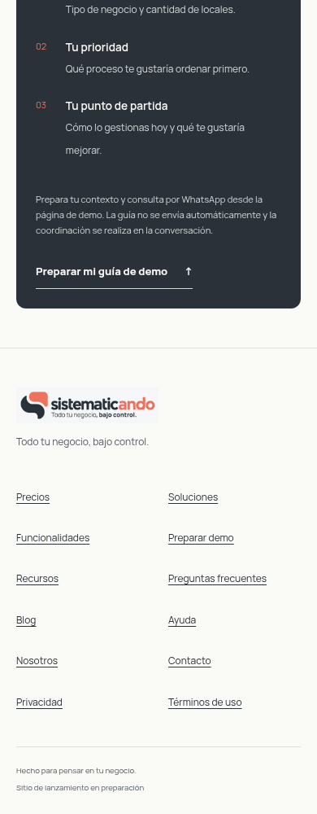

# Vista previa de la web de lanzamiento

Borrador preparado para el producto completo previsto. El propietario confirmó que el software está parcialmente desarrollado y que no se publicarán nuevas versiones hasta completar producto y web y autorizar el lanzamiento.

42 páginas HTML y 34 editores CMS. Las 14 fichas de módulos contienen propuesta, resumen, beneficios, recorrido, ámbito y enlaces relacionados. Home, sectores, FAQ y precios adoptan el mismo enfoque comercial. Precios usa consulta de propuesta personalizada; no hay montos, planes ni condiciones contractuales inventadas.

Las imágenes siguientes son capturas de la **web**, no pantallas del software ni evidencia de su disponibilidad operativa. El aviso de vista previa es editable en Marca; mantenerlo activo durante preparación. Los estados/evidencias internos permanecen separados.

## Móvil

## Escritorio

## Revisar en local

Compilar y usar npm run dev o npm run preview. Abrir /funcionalidades/ y las fichas, por ejemplo /funcionalidades/punto-de-venta/, /funcionalidades/inventarios/ y /funcionalidades/eventos-y-entradas/. El ZIP local generado contiene 42 páginas; no se ha desplegado.

Contenido: Funcionalidades → módulo → Contenido comercial para lanzamiento. Etiquetas comunes: Página: feature-detail. Estado real: FEATURE_STATUS.md; resumen/pendientes en PROGRESS.md. No enviar esta rama al Worker durante preparación.

## Empresa y Ayuda

Nosotros, Ayuda y Blog con tres artículos están implementados. Capturas del build local actual; no corresponden al Worker publicado ni prueban funcionalidad del SaaS. Ayuda y artículos mantienen navegación nativa sin JavaScript.

Revisar también /blog/ y /blog/elegir-que-ordenar-primero/. CMS: Blog: artículos editoriales, páginas nosotros-index, ayuda-index, blog-index y blog-article. Versión de borrador, sin publicación.

## Implementación y recorrido comercial

Revisar /precios/, /implementacion/ y /solicitar-demo/. La nueva página describe acuerdos de planificación, no servicios/plazos garantizados. Los campos estructurados se editan en Implementación: recorrido y preparación; textos en Página: implementacion-index. 42 páginas / 34 editores; sigue sin desplegarse.

## Privacidad y términos de uso (borradores)

Revisar /legal/privacidad/ y /legal/terminos/, enlazadas entre sí y en el pie. Secciones en Legal: términos de uso del sitio; copy en páginas legal-privacidad/legal-terminos. Los textos no son contrato SaaS ni adopción legal confirmada. Límites y decisiones pendientes: LEGAL_REVIEW.md.

## Recuperación desde errores y cierre técnico

La 404 usa descripción propia y enlaces Inicio/Ayuda. Se revisó en Worker local y con teclado, con/sin JS; no se desplegó. RELEASE_CHECKLIST.md enumera las 42 páginas y pendientes de lanzamiento.

## Revisión visual local y pie adaptable

Galería reproducible de las 42 rutas a 390/1440 y once estados: `npm run review:visual -- /tmp/sistematicando-visual`. Primera pantalla, cuerpo completo y pie disponibles fuera del checkout. Resultados y límites en VISUAL_REVIEW.md. La siguiente imagen es captura del sitio, no pantalla ni evidencia de disponibilidad del SaaS.

