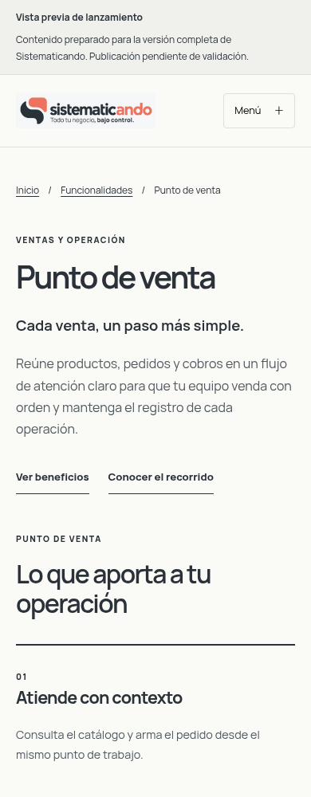
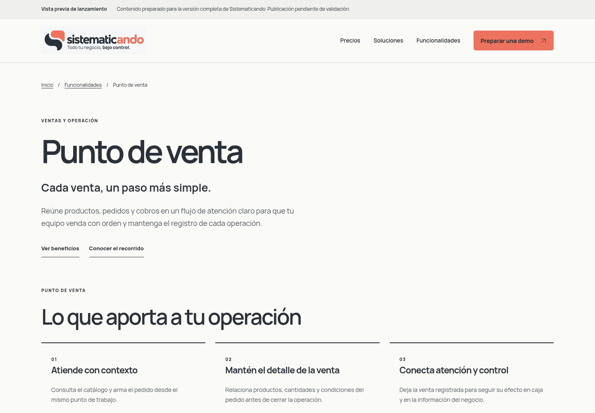

# Vista previa de la web de lanzamiento

Borrador preparado para el producto completo previsto. El propietario confirmó que el software está parcialmente desarrollado y que no se publicarán nuevas versiones hasta completar producto y web y autorizar el lanzamiento.

34 páginas HTML y 25 editores CMS. Las 14 fichas de módulos contienen propuesta, resumen, beneficios, recorrido, ámbito y enlaces relacionados. Home, sectores, FAQ y precios adoptan el mismo enfoque comercial. Precios usa consulta de propuesta personalizada; no hay montos, planes ni condiciones contractuales inventadas.

Las imágenes siguientes son capturas de la **web**, no pantallas del software ni evidencia de su disponibilidad operativa. El aviso de vista previa es editable en Marca; mantenerlo activo durante preparación. Los estados/evidencias internos permanecen separados.

## Móvil

## Escritorio

## Revisar en local

Compilar y usar npm run dev o npm run preview. Abrir /funcionalidades/ y las fichas, por ejemplo /funcionalidades/punto-de-venta/, /funcionalidades/inventarios/ y /funcionalidades/eventos-y-entradas/. El ZIP local generado contiene 34 páginas; no se ha desplegado.

Contenido: Funcionalidades → módulo → Contenido comercial para lanzamiento. Etiquetas comunes: Página: feature-detail. Estado real: FEATURE_STATUS.md; resumen/pendientes en PROGRESS.md. No enviar esta rama al Worker durante preparación.
